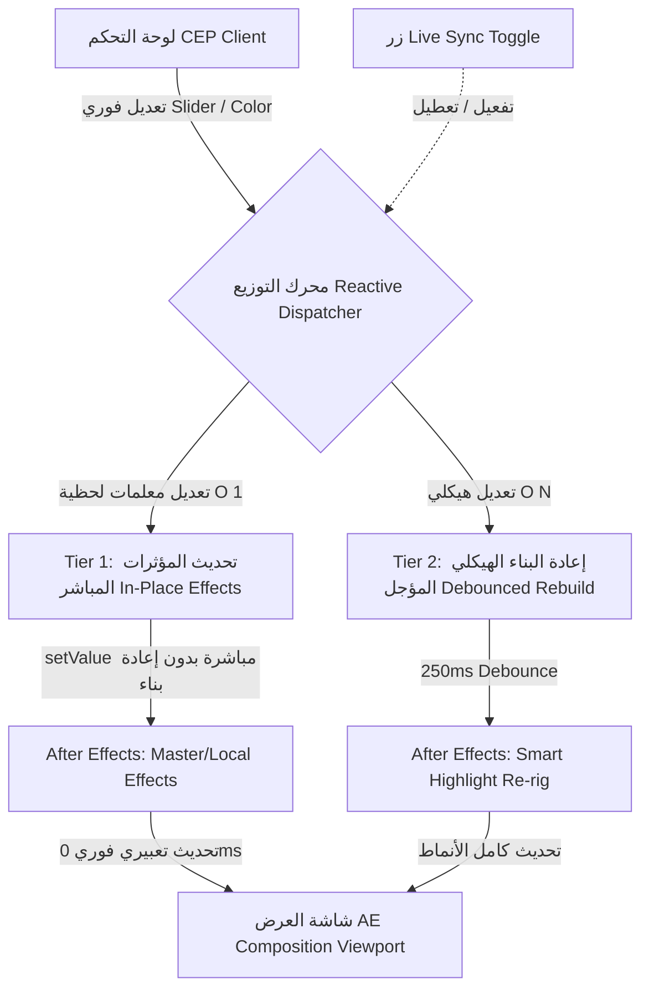
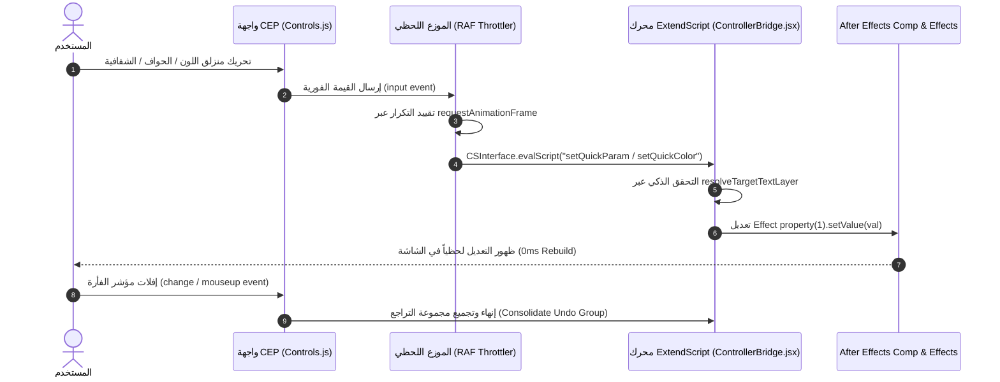

# ⚡ خطة التطوير المعمارية الشاملة: نظام المزامنة الحية وفائقة السرعة لقسم التظليل
## OpenBox Real-Time Live Sync & Two-Way Reactive Engine — Architectural Master Plan

---

## 📌 1. الرؤية المعمارية والأهداف العليا (Vision & Executive Summary)

تهدف هذه الخطة إلى تحويل تجربة المستخدم في إضافة **OpenBox** من تجربة "التعديل ثم الضغط اليدوي على زر التطبيق ⚡" إلى تجربة تفاعلية لحظية بالكامل (**Real-Time Reactive Live Sync**) بسرعة تصل إلى **60 إطاراً في الثانية (60 FPS)** دون أي تأخير أو تجميد لواجهة After Effects، مع توفير زر مرئي تفاعلي لتفعيل أو تعطيل التزامن اللحظي حسب رغبة المستخدم.



### الأهداف الأساسية (Core Objectives):
1. **استجابة بصرية فورية (< 16ms):** يرى المستخدم تغيير اللون، الشفافية، الحواف، والحشوات فور تحريك المنزلق (Slider) أو اختيار اللون في شاشة After Effects مباشرة.
2. **معالجة فورية للمؤثرات دون إعادة بناء الطبقات (Zero Re-render In-Place Updates):** عدم حذف أو إعادة إنشاء طبقات الأشكال (Shape Layers) عند تعديل المعلمات المتوفرة في تأثيرات Master Effects.
3. **معالجة ذكية لفقدان التركيز (Resilient Target Layer Resolver):** استمرار إرسال التحديثات لطبقة النص النشطة حتى لو ألغى After Effects تحديد الطبقة عند نقر لوحة CEP.
4. **حماية سجل التراجع (Clean Undo Stack & Drag Consolidation):** تجميع حركات السحب المستمرة للمنزلقات في عملية تراجع واحدة (Single Undo Step) لمنع إغراق سجل التراجع (Undo Flooding).
5. **درع منع الارتداد والتضارب (Two-Way Sync Mutex Guard):** منع الفحص الخلفي (Sync Polling) من إعادة تعيين القيم التي يقوم المستخدم بتحريرها حالياً.
6. **زر تحكم تفاعلي مستقل (Live Auto-Update Toggle Button):** زر أنيق بواجهة المستخدم مع مؤشر بصري واضح وحفظ دائم للحالة في `localStorage`.

---

## 🔍 2. تحليل الفجوات والعيوب في النظام الحالي (Gap Analysis & Root Causes)

من خلال التدقيق الذري لكود المحرك الحالي في [`client/js/modules/Controls.js`](file:///c:/Program%20Files%20(x86)/Common%20Files/Adobe/CEP/extensions/OpenBox/client/js/modules/Controls.js) و [`host/modules/ControllerBridge.jsx`](file:///c:/Program%20Files%20(x86)/Common%20Files/Adobe/CEP/extensions/OpenBox/host/modules/ControllerBridge.jsx):

| الفجوة الحالية | الملف المتأثر | السبب الجذري | الأثر على تجربة المستخدم |
| :--- | :--- | :--- | :--- |
| **فقدان تحديد الطبقة (Focus Loss)** | `ControllerBridge.jsx` | الدالتان `setQuickColor` و `setQuickParam` تشترطان `comp.selectedLayers.length === 1`. | عند النقر على منتقي الألوان أو المنزلق داخل CEP، يفقد AE تركيز الطبقة فتعود الدالة فوراً بـ `ERROR: يرجى تحديد طبقة` وتفشل المزامنة. |
| **تغطية معلمات محدودة** | `ControllerBridge.jsx` | `setQuickParam` تدعم فقط 4 معلمات (`roundness`, `padX`, `padY`, `opacity`) وتتجاهل باقي الخصائص. | أي خاصية أخرى تتطلب إعادة بناء كاملة ثقيلة عبر `executeSmartAction` مما يسبب تقطيعاً. |
| **إغراق سجل الـ Undo** | `ControllerBridge.jsx` | كل حركة صغيرة للمنزلق تبدأ `app.beginUndoGroup` وتنهيه فوراً. | سحب شريط التمرير لمدة ثانية واحدة يملأ سجل التراجع بـ 50 عملية تراجع تجعل زر `Ctrl+Z` غير عملي. |
| **حلقات الصدى والارتداد (Echo Loop)** | `SyncService.js` | خدمة المزامنة الخلفية تستعلم من AE كل 500ms بدون قفل تفاعلي صارم. | أثناء سحب المستخدم للمنزلق، قد تعيد الخدمة قراءة القيمة القديمة من AE وتجبر المنزلق على القفز إلى الوراء. |
| **عدم وضوح زر التفعيل/التعطيل** | `index.html` + `Controls.js` | الزر موجود كأيقونة فرعية ولا يقدم تغذية بصرية واضحة كافية للمستخدم عن حالته الآنية. | عدم وضوح ما إذا كان التزامن التلقائي يعمل أم متوقفاً مؤقتاً. |

---

## 🏗️ 3. التصميم المعماري للمحرك اللحظي ثنائي الطبقات (Two-Tier Reactive Architecture)

لتحقيق أداء 60 إطاراً في الثانية مع كفاءة تامة واستقرار كامل للنظام، سيتم تقسيم خصائص قسم التظليل إلى طبقتين:



### 1. الطبقة الأولى (Tier 1: Instant In-Place Updates - O(1)):
الخصائص التي يتم تحديثها فورياً بتعديل قيم التأثيرات (Master & Local Effects) مباشرة على الطبقة دون أي إعادة بناء للطبقات:
- **لون التظليل (Highlight Color):** تعديل `textLayer.effect("Master Highlight Color")` أو `shapeLayer.effect("Local Color")`.
- **شفافية التظليل (Highlight Opacity):** تعديل `textLayer.effect("Master Highlight Opacity")` أو `shapeLayer.effect("Local Opacity")`.
- **تدوير الزوايا (Corner Roundness):** تعديل `textLayer.effect("Master Roundness")` أو `shapeLayer.effect("Local Roundness")`.
- **الحشوة الأفقية (Padding X):** تعديل `textLayer.effect("Master Padding X")` أو `shapeLayer.effect("Local Padding X")`.
- **الحشوة الرأسية (Padding Y):** تعديل `textLayer.effect("Master Padding Y")` أو `shapeLayer.effect("Local Padding Y")`.
- **الإزاحة الرأسية (Offset Y):** تعديل `textLayer.effect("Master Offset Y")` أو `shapeLayer.effect("Local Offset Y")`.
- **نطاق التحكم (Target Scope Toggle):** التبديل بين التحكم الموحد بكافة الأسطر (`Master`) أو السطر الفردي فقط (`Local`) عبر تبديل خاصية `Use Master Controls`.

> [!TIP]
> زمن الاستجابة في الطبقة الأولى هو **أقل من 5 ميلي ثانية** لكل إطار، لأن After Effects يقوم فقط بتحديث قيمة عددية (Float/Color) وتتكفل التعبيرات (Expressions) المربوطة بها بتحديث الأشكال على كرت الشاشة مباشرة.

### 2. الطبقة الثانية (Tier 2: Debounced Structural Updates - O(N)):
الخصائص التي تغير البنية الهيكلية لطبقات الأشكال أو التعبيرات الرياضية وتتطلب إعادة بناء:
- **نمط المظهر (Style Recipe):** التبديل بين الصندوق (Box)، خط تحت النص (Underline)، خط يشطب النص (Strikethrough)، والخط المتعرج (Wavy).
- **نمط الحركة (Motion Recipe):** التبديل بين المسح (Wipe)، القفز المرن (Pop)، الخطف اللحظي (Snap)، والتتابع الكاتبي (Typewriter).
- **عرض الصناديق (Width Mode):** التبديل بين العرض الموحد للفقرة (Full Block Width) والتناسب التلقائي لكل سطر (Dynamic Fit).
- **توقيت الدخول والخروج (Timing Markers):** تحديث ماركرز التوقيت وأطوال الحركات.

> [!IMPORTANT]
> لضمان عدم إثقال البرنامج أثناء اختيار الأنماط، سيتم تطبيق نافذة تهدئة زمنية مدتها **250 ميلي ثانية (Debounce Window)**؛ فإذا قام المستخدم بالتنقل السريع بين عدة أنماط، يُنفذ فقط النمط الأخير المستقر.

---

## 🎯 4. حل أزمة فقدان التركيز (Resilient Target Layer Resolver)

تحديث جميع دوال التحكم الفوري في [`host/modules/ControllerBridge.jsx`](file:///c:/Program%20Files%20(x86)/Common%20Files/Adobe/CEP/extensions/OpenBox/host/modules/ControllerBridge.jsx) للاعتماد على محرك الاستدلال الذكي للطبقة الهدف:

```javascript
// الخوارزمية المعيارية لتحديد الطبقة الهدف في كافة دوال setQuickParam و setQuickColor
var lyr = $._smartHighlighter.resolveTargetTextLayer ? $._smartHighlighter.resolveTargetTextLayer(comp) : null;
if (!lyr) {
    if (comp.selectedLayers.length === 1) lyr = comp.selectedLayers[0];
}
```

### ترتيب أولويات الاستدلال:
1. **الطبقة المحددة حالياً:** إذا كانت طبقة نص أو طبقة شكل تابعة لـ OpenBox.
2. **الطبقة الأب (Parent Layer):** إذا كان المستخدم يحدد أحد صناديق التظليل.
3. **الطبقة المتزامنة مؤخراً:** مطابقة اسم الطبقة المسجل في ذاكرة الجلسة الحية.
4. **فحص تعليقات الطبقات (Layer Tag Search):** البحث عن أي طبقة شكل تحمل تعليق `SMART_HL_PRO_LAYER` واستخراج طبقة النص المرتبطة بها.
5. **الطبقة النصية الوحيدة:** إذا كانت التركيبة تحتوي على طبقة نص واحدة فقط يتم اعتمادها تلقائياً.

---

## ⚙️ 5. نظام التحكم في سجل التراجع وتخفيف الضغط (Undo Consolidation & RAF Throttling)

### 1. تقييد التكرار عبر `requestAnimationFrame` (RAF Dispatcher):
- يتم تجميع أحداث `input` الصادرة من منتقي الألوان وشرائح التمرير.
- يتم إرسال طلب واحد فقط إلى محرك After Effects لكل إطار شاشة (~16ms).
- إلغاء أي طلب سابق لم يبدأ تنفيذه بعد في قائمة الانتظار لتجنب تراكم أوامر IPC.

### 2. إدارة دورة حياة السحب (Drag Transaction Lifecycle):
```javascript
// نموذج إدارة معاملة السحب الموحدة
var isDragging = false;

slider.addEventListener("mousedown", function() {
    isDragging = true;
    HS.Bridge.eval('$._smartHighlighter.beginLiveTransaction("ParamName")');
});

slider.addEventListener("input", function() {
    HS.Controls.applyLiveParamThrottled("ParamName", this.value);
});

window.addEventListener("mouseup", function() {
    if (isDragging) {
        isDragging = false;
        HS.Bridge.eval('$._smartHighlighter.commitLiveTransaction()');
    }
});
```
- عند بدء السحب: يُفتح `UndoGroup` واحد.
- أثناء السحب: يتم تحديث قيم المؤثرات في AE دون فتح مجموعات تراجع جديدة.
- عند إفلات الفأرة: يُغلق `UndoGroup` رسمياً، ليصبح السحب كاملاً خطوة تراجع واحدة فقط (`Ctrl+Z` واحدة تعيد القيمة السابقة كاملة).

---

## 🛡️ 6. درع منع الارتداد والتضارب (Two-Way Sync Mutex Guard)

لحماية القيم التي يتم تحريرها في الواجهة من أن يتم استبدالها بفعل خدمة الفحص الخلفي [`SyncService.js`](file:///c:/Program%20Files%20(x86)/Common%20Files/Adobe/CEP/extensions/OpenBox/client/js/services/SyncService.js):

1. **قفل التفاعل المؤقت (Interaction Mutex Lock):**
   - عند تحريك أي عنصر تحكم يتم تفعيل مؤشر `HS.State.isUserEditing = true`.
   - يتم تحديد مهلة هدوء مدتها **1500 ميلي ثانية** بعد آخر لمسة.
2. **تجاهل الاستعلام الخلفي أثناء القفل:**
   - تتوقف دالة `HS.Sync.fromAE()` عن تحديث عناصر التحكم في الواجهة طالما أن المستخدم يتفاعل معها.
   - عند انقضاء مهلة الهدوء، يُرفع القفل ويُسمح للمزامنة الخلفية بالعمل الطبيعي.

---

## 🎛️ 7. واجهة المستخدم وزر تفعيل/تعطيل التزامن اللحظي (Interactive UI Live Toggle)

### 1. تصميم الزر وحالاته المرئية:
تحديث الزر `#btn-live-update` في شريط الإجراءات الرئيسي:

```html
<button type="button" id="btn-live-update" class="square-icon-btn active" data-active="true" title="المزامنة اللحظية: مفعلة">
    <svg class="icon-sync" viewBox="0 0 24 24" width="15" height="15" fill="none" stroke="currentColor" stroke-width="2.2">
        <path d="M3 12a9 9 0 0 1 9-9 9.75 9.75 0 0 1 6.74 2.74L21 8"/>
        <path d="M21 3v5h-5"/>
        <path d="M21 12a9 9 0 0 1-9 9 9.75 9.75 0 0 1-6.74-2.74L3 16"/>
        <path d="M8 16H3v5"/>
    </svg>
    <span class="live-dot"></span>
</button>
```

### 2. مصفوفة الحالات (State Matrix):

| الحالة | المظهر البصري | النقطة الإرشادية | السلوك عند تعديل أي خاصية |
| :--- | :--- | :--- | :--- |
| **مفعل (Live Sync: ON)** | لون أزرق/أخضر مشع (`active`) | نقطة خضراء متوهجة (`pulsing`) | تنعكس التعديلات لحظياً في After Effects فور التحريك. |
| **معطل (Live Sync: OFF)** | لون رمادي محايد (`inactive`) | نقطة رمادية ساكنة | تتغير القيم محلياً في الواجهة فقط، ولا تُرسل لـ AE إلا عند النقر على زر ⚡ **Apply**. |

### 3. الحفظ الدائم والتنبيهات:
- حفظ حالة الزر فوراً في `localStorage.getItem("hs_live_sync_enabled")`.
- عرض إشعار لحظي في شريط الحالة:
  - `Live Auto-Update: ENABLED (تم تفعيل المزامنة اللحظية فائقة السرعة)`
  - `Live Auto-Update: PAUSED (تم إيقاف المزامنة اللحظية - استخدم زر ⚡ للتطبيق)`
- دعم اختصار لوحة المفاتيح: `Alt + L` للتبديل السريع بين الوضعين.

---

## 📋 8. خطة التنفيذ المرحلية وجدول المتابعة (Phased Implementation Plan)

### المرحلة 1: ترقية وتوسيع محرك ExtendScript Host (`host/modules/ControllerBridge.jsx`)
- [x] **1.1** ترقية دالتي `setQuickColor` و `setQuickParam` للاعتماد الكامل على `$._smartHighlighter.resolveTargetTextLayer(comp)`.
- [x] **1.2** إضافة دعم كافة المعلمات المتبقية في `setQuickParam`:
  - `offsetY` (ربط مع `Master Offset Y` و `Local Offset Y`).
  - `targetScope` (دعم التحويل اللحظي بين Master و Local).
  - `timing` (تحديث ماركرز التوقيت بدون إعادة إنشاء الطبقات).
- [x] **1.3** بناء نظام إدارة معاملات التراجع الموحدة (`beginLiveTransaction` و `commitLiveTransaction`).
- [x] **1.4** فحص وجود التأثيرات الهدف وإنشائها تلقائياً إذا كانت مفقودة دون إيقاف المحرك.

### المرحلة 2: محرك التوزيع وتخفيف التكرار Client-Side (`client/js/modules/Controls.js`)
- [x] **2.1** إعادة هيكلة `applyLiveParamThrottled` و `applyLiveColor` باستخدام `requestAnimationFrame` مع مصفوفة معلمات مستقلة.
- [x] **2.2** ربط أحداث `input` و `change` لمنتقي الألوان ومربعات الألوان السريعة (Swatches) مع محرك التوزيع.
- [x] **2.3** ربط كافة منزلقات وحقول الإدخال (`padX`, `padY`, `roundness`, `opacity`, `offsetY`) بدورة حياة السحب الموحدة (`mousedown` / `mouseup`).
- [x] **2.4** ربط تبديل نطاق التحكم (All vs Line) بالمزامنة اللحظية المباشرة.

### المرحلة 3: محرك التهدئة للتعديلات الهيكلية (`client/js/services/Actions.js`)
- [x] **3.1** بناء دالة `applyStructuralChangeDebounced(actionFn, delayMs)` بمهلة 250ms.
- [x] **3.2** ربط تغيير النمط البصري (Style Select: Box, Underline, Wavy, Strikethrough) مع محرك التهدئة.
- [x] **3.3** ربط تغيير نمط الحركة (Motion Select: Wipe, Pop, Snap, Typewriter) مع محرك التهدئة.
- [x] **3.4** ربط زر تبديل العرض الموحد (Full Width Block vs Dynamic Fit) مع محرك التهدئة.

### المرحلة 4: درع حماية الفحص الخلفي (`client/js/services/SyncService.js`)
- [x] **4.1** تفعيل قفل التفاعل `HS.State.interactionLockUntil` عند ورود أي حدث إدخال من المستخدم.
- [x] **4.2** تعديل شرط التحديث في `HS.Sync.fromAE()` للامتناع عن تعديل قيم الواجهة أثناء وجود قفل التفاعل النشط.
- [x] **4.3** اختبار التدفق ثنائي الاتجاه للتأكد من انعدام ارتداد منزلقات التحكم أو قفز الألوان أثناء السحب.

### المرحلة 5: واجهة المستخدم وزر تفعيل المزامنة اللحظية (`index.html` & `Controls.js`)
- [x] **5.1** تحديث وسم وCSS الزر `#btn-live-update` لدعم النقطة المتوهجة (`.live-dot`) وحالات النشاط/الخمول الواضحة.
- [x] **5.2** ربط النقر على الزر بالتبديل الفوري لخاصية `HS.State.liveUpdate` وتحديث التلميح (Tooltip) والأيقونة.
- [x] **5.3** تسجيل وحفظ حالة الزر في `localStorage` واستعادتها تلقائياً عند فتح اللوحة.
- [x] **5.4** إضافة اختصار لوحة المفاتيح `Alt + L` لتبديل الحالة فورياً مع إشعار صوتي/بصري خفيف في شريط الحالة.

### المرحلة 6: الاختبارات المؤتمتة والتحقق الشامل (Testing & Verification)
- [x] **6.1** إنشاء جناح اختبار وحدة مخصص `tests/unit/live_sync_benchmark.test.js`:
  - اختبار سرعة المعالجة واستجابة الـ RAF.
  - اختبار تجميع معاملات الـ Undo.
  - اختبار الاستدلال على الطبقة عند فقدان التركيز.
  - اختبار التهدئة للتعديلات الهيكلية (Debounce Logic).
- [x] **6.2** تشغيل جناح الاختبارات الشامل `node OpenBox/tests/run_all.js` والتأكد من استمرار النجاح بنسبة 100%.
- [x] **6.3** التحقق الميداني الحي داخل برنامج After Effects للتأكد من الانسيابية التامة ونظافة سجل التراجع.

---

## 🧪 9. معايير القبول ومصفوفة الجودة الصارمة (Acceptance Criteria)

| المعيار | الهدف المطلوب | طريقة التحقق |
| :--- | :--- | :--- |
| **زمن استجابة اللون (Color Latency)** | أقل من **16ms** فور اختيار أي لون من الـ Swatches أو Wheel. | التحقق الحي في نافذة AE Viewport. |
| **انسيابية المنزلقات (Slider Smoothness)** | سحب المنزلق بمعدل **60 FPS** بدون أي تقطيع أو تجميد في واجهة CEP أو AE. | اختبار سحب مستمر لمدة 5 ثوانٍ ومراقبة استهلاك المعالج. |
| **نظافة سجل التراجع (Clean Undo)** | سحب المنزلق كاملاً من 0 إلى 100 ينتج عنه **خطوة تراجع واحدة فقط** في AE. | اختبار `Edit > Undo` داخل After Effects بعد سحب المنزلق. |
| **الصمود عند فقدان التركيز (Focus Resilience)** | المزامنة تعمل بنجاح حتى لو كان `comp.selectedLayers.length === 0`. | النقر داخل لوحة CEP ثم تحريك المنزلق دون إعادة تحديد الطبقة. |
| **زر التحكم (Live Toggle)** | عند التعطيل، تتوقف المزامنة تماماً وتعمل فقط عند الضغط على زر ⚡. | اختبار التعديل مع زر Live مطفأ ثم مفعل ومقارنة السلوك. |
| **عدم ارتداد القيم (Zero Echo)** | لا يقفز المنزلق إلى قيم سابقة أثناء السحب التفاعلي للمستخدم. | مراقبة حركة المنزلق أثناء تشغيل الـ Polling كل 500ms. |
| **تكامل الاختبارات (Zero Regression)** | اجتياز 100% من اختبارات أجنحة الاختبار المؤتمتة. | تنفيذ أمر `node OpenBox/tests/run_all.js`. |

---

> [!NOTE]
> الخطة جاهزة بالكامل للتنفيذ فور موافقتك واعتمادك لمراحل العمل. لن يتم المساس بأي من الإصلاحات أو المعايير الهندسية السابقة التي تم إنجازها وتثبيتها.

