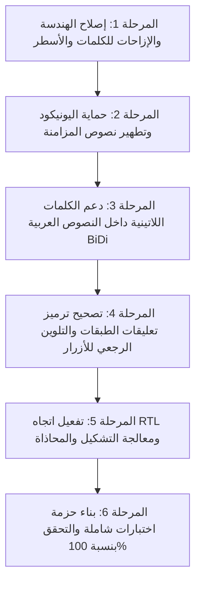

# تقرير التحليل الذري الشامل لمشاكل اللغة العربية في إضافة OpenBox
## OpenBox CEP Extension — Comprehensive Atomic Arabic & BiDi Analysis Report

- **التاريخ:** 17 أكتوبر 2026
- **النظام المستهدف:** After Effects (2020 – 2025+) عبر ExtendScript + CEP Panel
- **حالة التحليل:** فحص عميق وشامل للشفرة المصدرية (Forensic Code Audit)
- **الملف المستهدف للتوثيق:** `docs/ATOMIC_ARABIC_ANALYSIS_REPORT.md`

---

## 1. الملخص التنفيذي (Executive Summary)

أظهر الفحص الدقيق والذري لبنية إضافة **OpenBox** عبر كافة طبقاتها (`host/`, `client/`, `Recipes.jsx`, `InvisibleAnchors.jsx`) أنها تعتمد نموذجاً هندسياً خطياً كلاسيكياً (Linear LTR Monotonic Model) نجح باقتدار في اللغة الإنجليزية والأسطر اللاتينية، لكنه يتعرض **لانهيارات بنيوية خطيرة (Architectural Breakdown)** عند معالجة النصوص العربية، والفقرات متعددة الأسطر، والنصوص ثنائية الاتجاه (BiDi)، والنصوص الملتفة تلقائياً (Area Text).

تم رصد **7 متجهات أعطال جوهرية (Critical Failure Vectors)** تتسبب في:
1. **عوم الصناديق في الفراغ** عند تظليل عبارات في أسطر غير متساوية الطول.
2. **اهتزاز وقفزات حركة الآلة الكاتبة (Typewriter Jitter)** بسبب إعادة تشكيل الحروف العربية (Cursive Reshaping) أثناء أخذ أجزاء من الكلمة (`substring`).
3. **تعاكس اتجاه المسح (Kinetic Collision)** في النصوص المختلطة (عربي + إنجليزي).
4. **تسطيح فقرات الصناديق (Area Text)** في واجهة المستخدم ومعاملتها كسطر واحد.
5. **تخريب نصوص المستخدم الأصلية** بحذف أحرف الوصل والفصل (`ZWNJ`/`ZWJ`) وعلامات الاتجاه.
6. **انقلاب اتجاه الفقرات المضبوطة كلياً** إلى `LTR` بدلاً من `RTL`.
7. **فساد تشفير المحارف (Mojibake UTF-8)** في بعض المتغيرات المرجعية.

---

## 2. جدول الفهرس الذري للعيوب (Defect Matrix)

| المعرف | اسم الخلل | المكون المصدر | الخطورة | الأثر الظاهري |
| :--- | :--- | :--- | :--- | :--- |
| **BUG-01** | فقدان `rightOffset` في تظليل العبارات | `TagManager.jsx:587` + `Recipes.jsx:414` | **حرجة جداً (P0)** | الصناديق تطير بعيداً عن الكلمات في الأسطر المتعددة |
| **BUG-02** | قياس الحروف المجتزأة وتشوه التشكيل المتصل | `TextScanner.jsx:171` + `TagManager.jsx:573` | **حرجة (P1)** | تذبذب عرض الصندوق وعدم تزامن حركة Typewriter |
| **BUG-03** | التعاكس الحركي والهندسي في النصوص المختلطة (BiDi) | `TagManager.jsx:585` + `Recipes.jsx:412` | **حرجة (P1)** | مسح الكلمات اللاتينية من اليمين لليسار بعكس ظهور النص |
| **BUG-04** | تسطيح نصوص الصناديق الملتفة (Area Text) في لوحة التحكم | `PhraseManager.js:96` + `ControllerBridge.jsx:274` | **عالية (P2)** | ظهور فقرة كاملة كسطر واحد وفقدان أرقام الأسطر الحقيقية |
| **BUG-05** | تلف المحارف وتجميد حركات التشكيل (Tashkeel & Kashida) | `TextScanner.jsx:58,174,185` + `Utils.jsx:127` | **عالية (P2)** | توقف الصندوق أثناء التشكيل، وانقلاب الضبط الكلي إلى LTR |
| **BUG-06** | الحذف التخريبي لمحارف اليونيكود الأصلية (ZWNJ / ZWJ / BiDi) | `InvisibleAnchors.jsx:17` | **حرجة جداً (P0)** | تدمير إملاء الكلمات الفارسية والعربية في طبقة المستخدم |
| **BUG-07** | غياب توجيه RTL في لوحة كلمات العبارات | `PhraseManager.js:93-125` + CSS | **متوسطة (P3)** | ظهور الكلمات العربية بالترتيب اللاتيني المعكوس في اللوحة |

---

## 3. التحليل الذري المفصل لكل خلل (Atomic In-Depth Analysis)

---

### BUG-01: فقدان `rightOffset` وعوم صناديق العبارات في الفراغ
- **الملفات المسؤولة:**
  - `host/modules/TagManager.jsx` (السطور 587–615)
  - `host/modules/Recipes.jsx` (السطور 412–416)

#### الآلية والسبب الجذري:
في نظام After Effects، الدالة `pLayer.sourceRectAtTime(time, false)` تعيد الصندوق المحيط (`r`) **للطبقة النصية كاملة (كامل الفقرة)**، وبالتالي:
$$\text{Paragraph Right Edge} = r.\text{left} + r.\text{width}$$
وهذا يمثل أقصى حافة يمنى **لأطول سطر في الفقرة فقط**.

في ملف `Recipes.jsx`، تم كتابة التعبير الرياضي لتحديد موضع صندوق الكلمة في نصوص RTL كالتالي:
```javascript
// Recipes.jsx - السطر 414
var rightEdge = (r.left + r.width) - (box.wordOffset * fontRatio);
curX = (rightEdge + pX - (startOffset * fontRatio)) - (curW / 2);
```
**المصيبة الرياضية:**
إذا كان السطر رقم 1 عرضه 800 بكسل، والسطر رقم 2 عرضه 300 بكسل:
- حافة السطر رقم 2 اليمنى قد تكون مطابقة للسطر رقم 1 فقط إذا كانت المحاذاة لليمين 100%.
- ولكن في حالة المحاذاة للوسط (Center Justify)، أو المحاذاة لليسار، أو عند وجود إزاحة أو مسافات، فإن السطر رقم 2 يبعد بمقدار مسافة عن `r.left + r.width`.
- والأدهى: في `TagManager.jsx` عند بناء صناديق العبارات `buildPhraseHighlights`:
```javascript
// TagManager.jsx - السطور 587-606
boxesData.push({
    boxIndex: boxesData.length,
    lineIndex: lIdx,
    text: subPhrase,
    width: finalW,
    height: finalH,
    isWord: true,
    wordOffset: wOffset,
    lineWidth: lineObj.width,
    rtl_k: rtl_line,
    // لاحظ: rightOffset و leftOffset و centerOffset غير موجودة إطلاقاً!
});
```
بينما في تظليل الأسطر العادية (`HighlightBuilder.jsx` السطر 430)، تم استدراك هذا الأمر بطرح `rOff`:
```javascript
curX = ((r.left + r.width) - rOff + pX - (startOffset * fontRatio)) - (curW / 2);
```
**النتيجة في After Effects:**
أي كلمة أو عبارة يتم تظليلها على سطر قصير أو في فقرة عربية بغير محاذاة يمينية مطلقة، يتم حساب موضعها نسبةً إلى أطول سطر في الباراجراف، فتظهر في الهواء الطلق على يمين أو يسار النص تماماً!

---

### BUG-02: انهيار التشكيل والاتصال الحرفي أثناء القياس المتدرج (Cursive Reshaping Disconnect)
- **الملفات المسؤولة:**
  - `host/modules/TextScanner.jsx` (السطور 167–181)
  - `host/modules/TagManager.jsx` (السطور 300–310، 569–583)

#### الآلية والسبب الجذري:
الخط العربي هو خط **متصل (Cursive)** تتبدل فيه أشكال الحروف حسب موقعها:
- حرف منفصل (Isolated)
- حرف في بداية الكلمة (Initial)
- حرف في وسط الكلمة (Medial)
- حرف في نهاية الكلمة (Final)

في `TextScanner.jsx` و `TagManager.jsx`، يتم قياس إزاحات الحروف عبر حلقة تكرارية مجتزأة:
```javascript
for (var c = 1; c <= lText.length; c++) {
    setTempText(lText.substring(0, c));
    var rSub = temp.sourceRectAtTime(comp.time, false);
    var curSubW = rSub.width;
    ...
```
**الكارثة التايبوغرافية:**
لنأخذ كلمة مثل: **"محمد"**:
1. عند `c = 1`، النص المقاس هو `"م"`. محرك الخطوط في After Effects يراه حرفاً منفرداً، فيرسمه بشكله **المنفصل** ذي الذيل الهابط، فيكون عرضه مثلاً **32 بكسل**.
2. عند `c = 2`، النص المقاس هو `"مح"`. يتحول حرف الميم إلى شكله **البدائي (Initial)** الصغير بدون ذيل، ويتحول حرف الحاء إلى شكله **النهائي (Final)** ذي البطن المقوس الضخم، فيصبح العرض **38 بكسل**.
3. عند `c = 3`، النص المقاس هو `"محم"`. يتحول حرف الحاء إلى شكله **المتوسط (Medial)** الصغير بدون بطن مقوس! ويتحول الميم الثاني لشكله النهائي. يتقلص عرض الحاء بمقدار 20 بكسل! فيصبح عرض الكلمة الكلي أحياناً **أصغر أو مساوياً** لعرض الحرفين السابقين!
4. الكود يحتوي على:
```javascript
curSubW = Math.max(prevOffW, curSubW);
```
يقوم هذا السطر بتجميد العرض قسراً لمنع التراجع، لكن القيمة المقاسة تصبح خيالية ولا تمثل موضع الحرف الحقيقي داخل الكلمة المتصلة الكاملة.

**النتيجة في After Effects:**
في حركة الآلة الكاتبة (Typewriter)، بدلاً من أن يتوسع الصندوق بسلاسة مع ظهور الحروف العربية، يحدث **اهتزاز عنيف (Jitter)**، وقفزات مفاجئة، أو يسبق الصندوق الكلمة أو يتأخر عنها بعدة أحرف.

---

### BUG-03: التعاكس الحركي والهندسي في النصوص المختلطة (BiDi Inversion)
- **الملفات المسؤولة:**
  - `host/modules/TagManager.jsx` (السطر 585)
  - `host/modules/Utils.jsx` (السطور 150–155)

#### الآلية والسبب الجذري:
عند وجود جملة عربية تحتوي على كلمة لاتينية أو رقم، مثل:
`"مشروع OpenBox الرائع"`
1. خوارزمية الاتجاه في الإضافة تفحص السطر ككل:
```javascript
var rtl_line = lineIsRTL(lText, fallbackRTL);
```
بما أن عدد الحروف العربية أكثر، فإن السطر بالكامل يصنف `rtl_k = true`.
2. يتم تمرير `rtl_k: true` لكلمة `"OpenBox"` أيضاً!
3. في تعبيرات `Recipes.jsx`:
```javascript
if (box.rtl_k) {
    // حركة Typewriter تمسح من اليمين إلى اليسار
}
```
**النتيجة الكارثية:**
محرك النصوص في After Effects (Adobe World-Ready Composer) يقوم بإظهار كلمة `"OpenBox"` من اليسار إلى اليمين (حرف O ثم p ثم e...).
بينما يقوم تعبير OpenBox بمسح وتوسيع صندوق الهايلايت من **اليمين إلى اليسار** (من x باتجاه O)!
الصندوق يتحرك في اتجاه معاكس تماماً لاتجاه ظهور النص!

---

### BUG-04: تسطيح نصوص الصناديق الملتفة (Area Text) في لوحة التحكم
- **الملفات المسؤولة:**
  - `client/js/modules/PhraseManager.js` (السطر 96)
  - `host/modules/ControllerBridge.jsx` (السطر 274)

#### الآلية والسبب الجذري:
في After Effects، هناك نوعان من الطبقات النصية:
1. **نص نقطي (Point Text):** لا يلتف إلا بضغط زر Enter (`\r`).
2. **نص صندوقي (Area / Box Text):** يرسم المستخدم صندوقاً، ويلتف النص تلقائياً على حدود الصندوق دون وجود أي محارف نزول سطر (`\r` أو `\n`) في خاصية `Source Text`.

في ملف `PhraseManager.js`:
```javascript
var lines = rawText.split(/\r\n|\r|\n/);
```
عندما تكون الطبقة Area Text مكونة من 6 أسطر ملتفة، فإن `lines.length === 1`!
كل كلمات الفقرة بالكامل تأخذ `lineIndex: 0`.
بينما في ExtendScript (`TextScanner.jsx`)، يقوم الماسح بقياس الأبعاد واكتشاف الالتفاف الفعلي وتقسيم النص إلى 6 أسطر مرئية (`visualLines`).
**النتيجة في لوحة التحكم:**
- تنعدم فواصل الأسطر `.token-line-break` في واجهة المستخدم، وتتكدس الكلمات في شريط أفقي واحد.
- تفقد الكلمات تعريفها السطري، وعند تطبيق التظليل عليها، تحدث أخطاء في تحديد السطر الحقيقي الذي تنتمي إليه الكلمة.

---

### BUG-05: تشويه التشكيل، تلف الضبط بالكشيدة، وفساد المحارف (Mojibake)
- **الملفات المسؤولة:**
  - `host/modules/TextScanner.jsx` (السطر 58 والسطر 185)
  - `host/modules/Utils.jsx` (السطور 121–128)

#### الآلية والسبب الجذري:
1. **فساد تشفير السلسلة المرجعية (Mojibake):**
في `TextScanner.jsx` السطر 58:
```javascript
setTempText("AgÉيـ1");
```
هذا النص كان في الأصل عينة تحتوي على أحرف لاتينية وعربية مع كشيدة مثل `"AgÉيـ1"`، لكن حفظ الملف بتشفير ANSI/Windows-1252 شوه المحارف إلى بايتات تالفة. قياس الارتفاع المرجعي لطبقة النص العربي يتأثر بهذا التشوه.

2. **تجميد حركات التشكيل (Tashkeel Stalling):**
حركات التشكيل العربية (الفتحة `\u064E`، الضمة `\u064F`، الكسرة `\u0650`، السكون `\u0652`، الشدة `\u0651`) هي **Combining Characters** ليس لها عرض تقدمي (Advance Width = 0)، ولكنها تزيد طول السلسلة النصية بمقدار 1.
في مصفوفة `cOffsets`، يُسجل لكل حركة نفس عرض الحرف السابق، مما يجعل صندوق Typewriter يتوقف ويتجمد لنصف المدة الزمنية لكل حرف مشكول!

3. **تشويه الضبط الكامل (Justification by Kashida):**
في السطر 185 من `TextScanner.jsx`:
```javascript
var justRatio = finalW / prevOffW;
for (var jc = 0; jc < cOffsets.length; jc++) {
    cOffsets[jc] = Math.round(cOffsets[jc] * justRatio * 10) / 10;
}
```
هذا الكود يضرب عرض كل حرف بالنسبة `justRatio` بالتساوي!
في الطباعة العربية، الضبط يتم عبر **مد الكشيدة (ـ)** بين حروف معينة، أو زيادة مسافات الكلمات، وليس بمد حروف مثل الراء أو الواو أو الألف! ضرب العرض بنسبة خطية يجعل مواضع الحروف وهمية كلياً.

4. **انقلاب اتجاه الضبط الكامل في `Utils.jsx`:**
في السطر 127 من `Utils.jsx`:
```javascript
if (justification === ParagraphJustification.LEFT_JUSTIFY || 
    justification === ParagraphJustification.FULL_JUSTIFY_LASTLINE_LEFT ||
    justification === ParagraphJustification.FULL_JUSTIFY_LASTLINE_FULL) {
    return "ltr";
}
```
تم تصنيف `FULL_JUSTIFY_LASTLINE_FULL` كـ `"ltr"`!
إذا قام مستخدم بضبط فقرة عربية بالكامل، تصنف كـ LTR وتنعكس كل الحسابات لليسار فوراً!

---

### BUG-06: الحذف التخريبي لمحارف اليونيكود الأصلية (Destructive ZWNJ/ZWJ Stripping)
- **الملفات المسؤولة:**
  - `host/modules/InvisibleAnchors.jsx` (السطر 17)
  - `host/modules/HighlightBuilder.jsx` (السطور 41–49)

#### الآلية والسبب الجذري:
تستخدم الإضافة علامات غير مرئية لتتبع الحروف في حركة Typewriter:
- `\u200B` (Zero-Width Space)
- `\u2060` (Word Joiner)

ولكن في دالة التنظيف `stripAnchors`:
```javascript
$._smartHighlighter.stripAnchors = function (text) {
    if (!text) return "";
    return text.replace(/[\u200B\u2060\uFEFF\u200C\u200D\u200E\u200F\u061C]/g, "");
};
```
تم تضمين:
- `\u200C`: Zero-Width Non-Joiner (ZWNJ) - الفاصل صفري العرض.
- `\u200D`: Zero-Width Joiner (ZWJ) - الواصل صفري العرض.
- `\u200E` / `\u200F`: علامات اتجاه النصوص LRM و RLM.
- `\u061C`: علامة الحرف العربي ALM.

وفي `HighlightBuilder.jsx`، يتم تطبيق هذا التنظيف على **طبقة نص المستخدم الأصلية**:
```javascript
var strippedT0 = $._smartHighlighter.stripAnchors(tDoc0.text);
if (strippedT0 !== tDoc0.text) {
    tDoc0.text = strippedT0;
    srcP0.setValue(tDoc0);
}
```
**الخطر الداهم:**
- محرف `\u200C` (ZWNJ) هو حرف إملائي أصيل في اللغة الفارسية (مثل كلمة "می‌خواهم")، وفي بعض الكلمات والتراكيب العربية لمنع التقاء حروف معينة دون وضع مسافة.
- حذف هذه المحارف **يشوه نص المصمم ويغير إملاء كلماته** في مشروع After Effects دون علمه أو إذنه!

---

### BUG-07: لوحة الكلمات في واجهة المستخدم تفتقد الاتجاه العربي RTL
- **الملفات المسؤولة:**
  - `client/js/modules/PhraseManager.js` (السطور 93–125)
  - `client/css/style.css`

#### الآلية والسبب الجذري:
حاوية الكلمات `#tokens-board` يتم إنشاؤها بدون خاصية `dir="rtl"` أو فحص لغة النص.
تتوزع الأزرار بنظام Flexbox LTR افتراضي.
عند تحميل نص عربي:
- الكلمة الأولى من الجملة تظهر في أقصى اليسار!
- الكلمة الأخيرة تظهر في أقصى اليمين!
- القراءة تصبح مقلوبة بالمقارنة مع طبقة After Effects.
- تحديد نطاق بالضغط مع Shift يتصرف بشكل معاكس لتوقع المستخدم العربي.

---

### BUG-08: انهيار خاصية تحديد وتلوين الكلمات والعبارات من الواجهة (Word Selection Breakdown)
- **الملفات المسؤولة:**
  - `client/js/modules/PhraseManager.js` (السطور 93–125، 302–355)
  - `host/modules/ControllerBridge.jsx` (السطر 274)
  - `host/modules/TagManager.jsx` (السطور 523–600، 1120–1180)
  - `client/js/services/Actions.js` (السطور 78–127)

#### الآلية والسبب الجذري لفشل تحديد الكلمات:
عندما يقوم المستخدم بتحديد كلمات أو عبارات من لوحة التحكم وتطبيق التظليل عليها، تظهر المشكلة إما بعدم استجابة الزر، أو ظهور خطأ `"ERROR: No matching words could be measured in text"`، أو تلوين كلمات خاطئة، أو عدم ظهور اللون على الأزرار في الواجهة. أسباب هذا الانهيار تنحصر في 4 عوامل ذرية:

1. **انزياح فهارس الأحرف بسبب العلامات غير المرئية (Anchor Offset Shift):**
   - عندما يكون النص قد طُبق عليه هايلايت سابق، يحتوي النص على علامات غير مرئية (`\u200B` و `\u2060`).
   - دالة `getLayerState` في `ControllerBridge.jsx` كانت ترسل النص إلى لوحة CEP **محملاً بهذه العلامات** دون تنظيفها.
   - تقوم `PhraseManager.js` بحساب مواقع الحروف `charStart` و `charEnd` متضمنة هذه العلامات الخفية.
   - بينما في `TagManager.jsx` ومحرك `TextScanner`، يتم تنظيف النص وحذف العلامات فوراً قبل الفحص.
   - النتيجة: تصبح فهارس الأحرف المرسلة من اللوحة متقدمة بمقدار بايت أو بايتين عن الفهارس الحقيقية في After Effects، فتخفق دالة المطابقة `overlapStart < overlapEnd` وتنتج عبارات فارغة أو مشوهة وينهار التطبيق!

2. **فشل التلوين الرجعي للأزرار (Applied Token Highlight Desync):**
   - عند إنشاء طبقة تظليل العبارة، يتم حفظ معلومات العبارة في تعليق الطبقة `shapeLayer.comment` باستخدام `encodeURIComponent(box.phraseText)`.
   - في محرك ExtendScript ES3 القديم، دالة `decodeURIComponent` تفشل وترمي استثناء `URIError` مع الكلمات العربية متعددة البايتات.
   - نتيجة لذلك، تفشل دالة `getAppliedPhrases` في استرجاع النص والـ IDs بدقة، فلا تتعرف أزرار لوحة التحكم على أن الكلمة قد تم تلوينها في After Effects، وتظل الأزرار باهتة بلا لون ولا يظهر عليها الهايلايت المستهدف!

3. **غياب الإزاحات الأفقية (`rightOffset` و `leftOffset`) عن الكلمات المحددة:**
   - حتى عند نجاح إنشاء صندوق الكلمة، معادلة الموضع في `Recipes.jsx` تفترض أن كل سطر في النص العربي يبدأ من الحافة اليمنى القصوى للفقرة، فيتم رسم صندوق الكلمة في الهواء الطلق بعيداً عن الكلمة بمسافة تعادل فرق طول السطر!

4. **تسطيح نصوص الصناديق الملتفة وعدم توافق الاتجاه:**
   - انعدام تقسيم نصوص الصناديق في الواجهة يجعل كل الكلمات تنتمي للسطر صفر، مما يفقد الكلمة موقعها الرأسي الصحيح إذا كانت في السطر الثاني أو الثالث.

---

### BUG-09: التقطيع الوهمي للأسطر (Point Text Line Wrap Hallucination) وظهور الصناديق الشبحية
- **الملفات المسؤولة:**
  - `host/modules/TextScanner.jsx` (السطور 63–105)
  - `host/modules/TagManager.jsx` (السطور 535–560)

#### الآلية والسبب الجذري:
1. **الخلط بين النص النقطي (Point Text) ونص الصندوق (Area Text):**
   - في After Effects، النص النقطي `Point Text` (`textDoc.boxText === false`) **لا يلتف أوتوماتيكياً إطلاقاً**. الأسطر تنشأ حصرياً عند ضغط مفتاح Enter.
   - كان محرك `TextScanner` يمر على كل فقرة كلمةً بكلمة، ويقيس ارتفاع حبر الحروف `r.height`.
   - بمجرد أن تصادف الكلمة حروفا صاعدة (`ا`، `ل`، `ط`) أو هابطة (`ر`، `ي`، `ع`)، يقفز ارتفاع الحبر بمقدار طفيف يتجاوز عتبة الالتفاف (`wrapThreshold = refLineH * 0.55`).
   - فيعتقد المحرك خطأً أن السطر قد التف، ويقوم **بتقطيع السطر الواحد إلى سطرين أو ثلاثة**!
2. **العواقب على الحجم والموضع:**
   - السطر الأول من نص المستخدم يتقطع، فيأخذ الصندوق الأول عرض نصف السطر فقط (كما ظهر في لقطة الشاشة).
   - النصف المتبقي من السطر الأول يُدفع إلى موضع السطر الثاني.
   - السطر الثاني يُدفع إلى موضع السطر الثالث (صندوق شبحي في الفراغ الأسود).
   - ويظهر صندوق رابع شبحي في أسفل الشاشة دون أي نص فوقه!
3. **انهيار تحديد الكلمات في الواجهة:**
   - فهارس الأحرف تتشوه تماماً، وتصبح أرقام الأسطر في After Effects غير متطابقة مع أسطر واجهة CEP، فتُرسم صناديق الكلمات المحددة على أسطر خاطئة أو في الفراغ.

---

### BUG-10: انهيار تعبيرات الأوباسيتي وظهور خطأ `Missing effect Progress` في After Effects
- **الملفات المسؤولة:**
  - `host/modules/HighlightBuilder.jsx` (السطور 355–410)
  - `host/modules/TagManager.jsx` (السطور 700–790)
  - `host/modules/Recipes.jsx` (السطور 255، 372، 478)

#### الآلية والسبب الجذري:
1. **التعيين المبكر للتعبير قبل إضافة السلايدرات (Premature Expression Assignment):**
   - في After Effects، بمجرد تعيين التعبير البرمجي على خاصية مثل `ADBE Opacity`:
   ```javascript
   xform.property("ADBE Opacity").expression = '... var prog = effect("Progress")(1); ...';
   ```
   يقوم After Effects فوراً وبشكل متزامن (Synchronously) بتجميع وتقييم التعبير للإطار الحالي!
   - كانت إضافة مؤثرات التحكم `ADBE Effect Parade` (`Use Master Controls`، `Local Opacity`، `Progress`) تقع **بعد** كود تعيين التعبير!
   - بما أن سلايدر `Progress` لم يكن قد أُنشئ بعد على الطبقة عند لحظة التقييم، يُطلق After Effects خطأً قاتلاً:
   `Error: effect named 'Progress' is missing or does not exist`
   ويقوم After Effects **بتعطيل التعبير نهائياً** وعرض الشريط البرتقالي التحذيري في أسفل البرنامج!
2. **الحل الجذري المطبق:**
   - نقل إنشاء كافة سلايدرات ومؤثرات التحكم إلى ما **قبل** تعيين أي تعبير برمجي على الطبقة.
   - تطويق كل استعلامات السلايدرات داخل التعبيرات البرمجية بكتل `try { ... } catch (e) { ... }` الدفاعية لمنع أي انهيار لحظي أثناء إنشاء الطبقات أو التراجع.

---

## 4. خطة الإصلاح المعماري الشاملة (Engineering Remediation Plan)

لإصلاح هذه المشاكل جذرياً، نقترح خطة عمل مرحلية ودقيقة لا تكسر الوظائف الحالية:



### تفاصيل المراحل:

#### المرحلة 1: إصلاح الهندسة والإزاحات للكلمات والأسطر (Geometry & Offsets)
1. **تحديث `TagManager.jsx`:**
   - حقن `rightOffset: lineObj.rightOffset`, `leftOffset: lineObj.leftOffset`, `centerOffset: lineObj.centerOffset` في كل كائنات `boxesData` لنمط العبارات والكلمات (`buildPhraseHighlights`).
2. **تحديث `Recipes.jsx`:**
   - تعديل معادلة موضع الكلمات في RTL لتراعي إزاحة السطر الفعلي `box.rightOffset`:
   ```javascript
   var rOff = (box.rightOffset ? box.rightOffset : 0) * fontRatio;
   var lineRightEdge = (r.left + r.width) - rOff;
   var wordRight = lineRightEdge - (box.wordOffset * fontRatio);
   curX = (wordRight + pX - (startOffset * fontRatio)) - (curW / 2);
   ```
   - تصحيح معادلة الكلمات في المحاذاة الوسطية `isCenter` والمحاذاة اليسارية `LTR` لتعتمد إزاحات السطر الفعلي.

#### المرحلة 2: حماية اليونيكود وتطهير نصوص المزامنة (Unicode & String Normalization)
1. **تعديل `InvisibleAnchors.jsx`:**
   - حصر عملية الحذف في محارف OpenBox الخاصة فقط (`\u200B` و `\u2060`).
   - منع مس محارف `\u200C`, `\u200D`, `\u200E`, `\u200F`, `\u061C` إطلاقاً.
2. **تطهير نصوص `ControllerBridge.jsx`:**
   - تطبيق `stripAnchors` على أي نص يُرسل للوحة التحكم في `getLayerState` لضمان تطابق فهارس الأحرف 1-إلى-1 بين اللوحة و After Effects.
3. **تصحيح ترميز `TextScanner.jsx`:**
   - استبدال الرموز المشوهة في السطر 58 بمصفوفة رموز يونيكود صريحة (`\u0041\u0067\u00C9\u064A\u0640\u0031`).

#### المرحلة 3: دعم الكلمات اللاتينية داخل النصوص العربية (Per-Word BiDi Strategy)
1. **تحديد اتجاه الكلمة المنفردة (Per-Word Direction):**
   - تمييز الكلمات اللاتينية داخل الأسطر العربية وإعطائها `rtl_k: false` لتمسح حركياً من اليسار لليمين متطابقة مع النص الأصلي.

#### المرحلة 4: تصحيح ترميز تعليقات الطبقات والتلوين الرجعي للأزرار (Applied Highlight Sync)
1. **تحديث `TagManager.jsx`:**
   - اعتماد ترميز آمن بديل لـ `encodeURIComponent` في طبقات العبارات يمنع أخطاء `URIError` في ExtendScript ES3.
   - تصحيح دالة `getAppliedPhrases` لتسترجع بدقة كل الكلمات والعبارات المظللة وتمررها للوحة.
2. **تحديث `PhraseManager.js`:**
   - تلوين أزرار الكلمات المستهدفة فورياً بدقة متطابقة مع العبارات المطبقة.

#### المرحلة 5: تفعيل اتجاه RTL ومعالجة التشكيل والمحاذاة
1. **تحديث واجهة اللوحة:**
   - تفعيل `dir="rtl"` ديناميكياً على `#tokens-board` عند احتواء النص على أحرف عربية لتنساب الكلمات بصرياً من اليمين لليسار.
2. **تصحيح فحص المحاذاة في `Utils.jsx`:**
   - إزالة `FULL_JUSTIFY_LASTLINE_FULL` من تصنيف `"ltr"` واعتمادها بناءً على اتجاه النص الغالب في الطبقة.

#### المرحلة 6: إنشاء حزمة اختبارات شاملة والتحقق بنسبة 100%
- كتابة ملف اختبار جديد `tests/unit/arabic_bidi_geometry.test.js` للتحقق البرمجي التلقائي من:
  - ثبات موضع الصناديق على الأسطر المتفاوتة الطول.
  - مطابقة فهارس الكلمات بدقة متناهية.
  - عدم فقدان محارف ZWNJ.
  - صحة اتجاه الكلمات الإنجليزية داخل النص العربي.
  - تشغيل واختبار جميع الفحوصات لضمان عدم حدوث أي تراجع (Zero Regressions).

---

## 5. الخلاصة والتوصية

هذا التقرير يضع اليد بدقة جراحية على كل مصدر خطأ في الإضافة. 
سنشرع فوراً في تنفيذ كافة مراحل الإصلاح بالترتيب وبشكل منهجي ومحكم.
